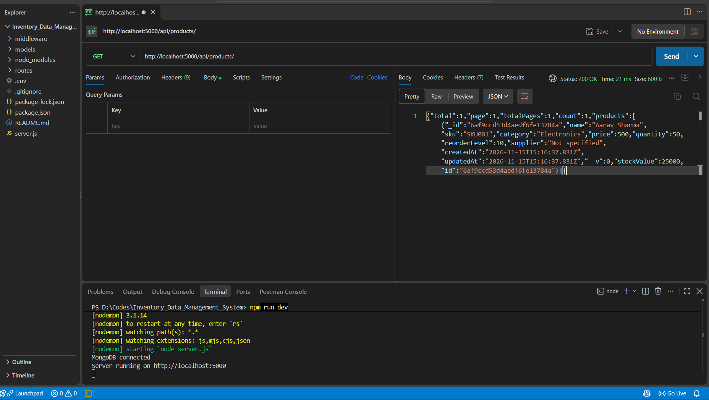
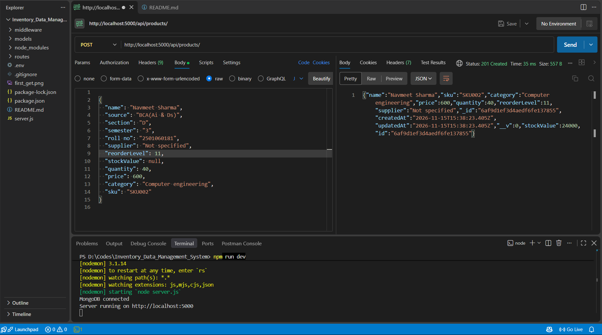
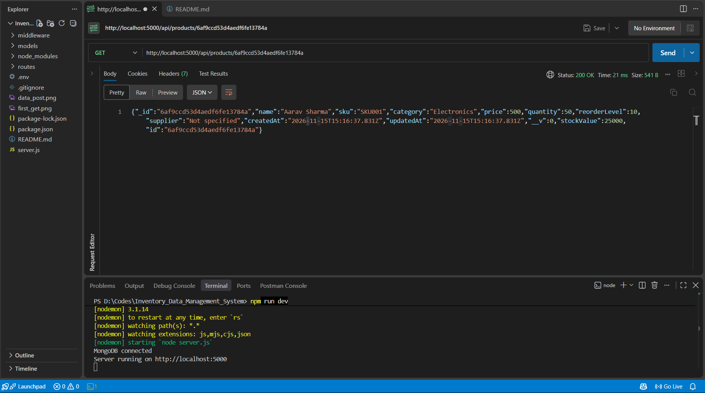
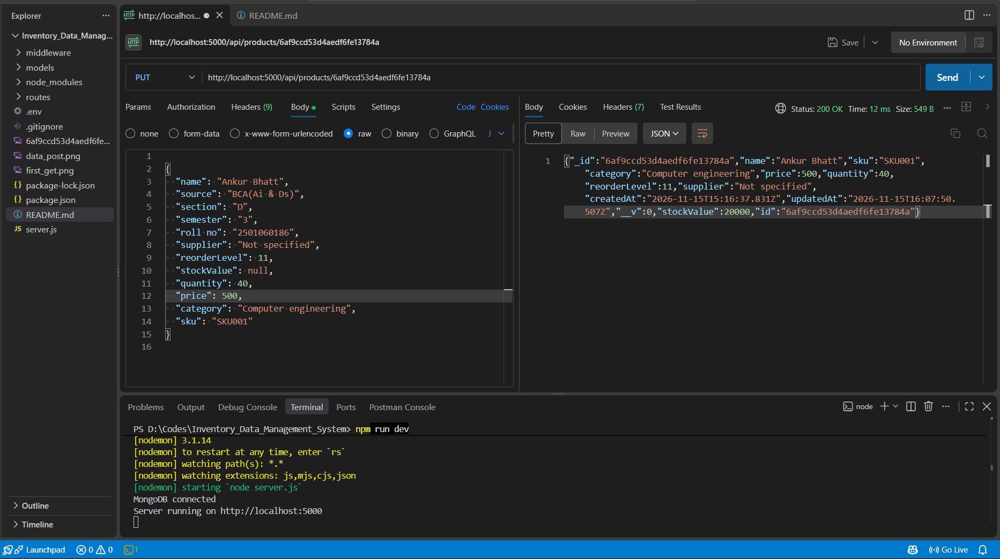

# Assignment 3: Inventory and Data Management System

**Course:** Web Dev III | **Unit:** 3 | **CO:** CO3 | **Marks:** 2.5

Backend REST API made using Node.js, Express.js, MongoDB, Mongoose and dotenv as stated in the assignment PDF.

## Setup
1. Install Node.js and MongoDB; ensure MongoDB is running.
2. In this folder run `npm install`.
3. Run `npm run dev` (or `npm start`).
4. API base URL: `http://localhost:5000/api/products`.

## API endpoints
| Method | Endpoint | Purpose |
|---|---|---|
| GET | `/api/products` | List products with filtering, sorting, pagination |
  

| POST | `/api/products` | Create a product |
  
| GET | `/api/products/:id` | Get one product |
  

| PUT | `/api/products/:id` | Update product details |

| PATCH | `/api/products/:id/stock` | Restock or record sale |

| DELETE | `/api/products/:id` | Delete product |

| GET | `/api/products/low-stock` | Low-stock alert report |
| GET | `/api/products/category-summary` | Category-wise aggregation summary |

## Example requests
- Filter: `GET /api/products?category=Stationery`
- Search: `GET /api/products?search=pen`
- Price range: `GET /api/products?minPrice=50&maxPrice=200`
- Sort: `GET /api/products?sort=price&order=asc`
- Pagination: `GET /api/products?page=1&limit=10`
- Sale: `PATCH /api/products/PRODUCT_ID/stock` body `{"operation":"sale","amount":2}`
- Restock: `PATCH /api/products/PRODUCT_ID/stock` body `{"operation":"restock","amount":10}`

## Notes
- SKU is unique; schema has field-level validation.
- Stock sale is conditionally applied only if enough quantity exists.
- Error middleware centralizes validation, duplicate SKU, invalid ID and not-found responses.
- `stockValue` is a Mongoose virtual calculated as `price * quantity`.
.......